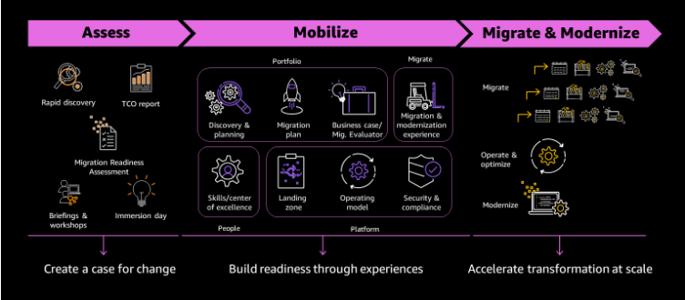
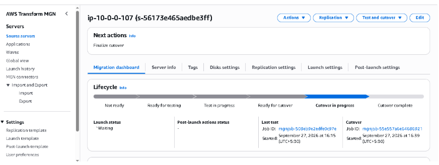
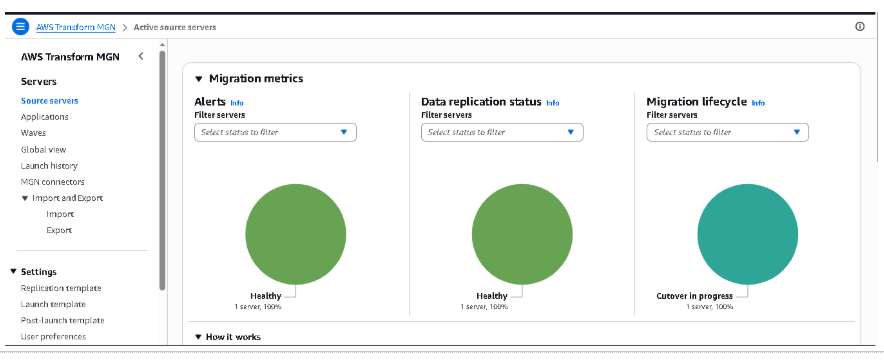
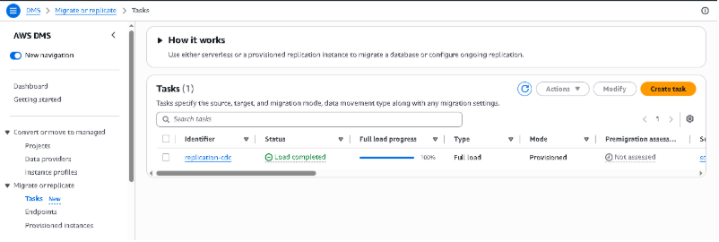
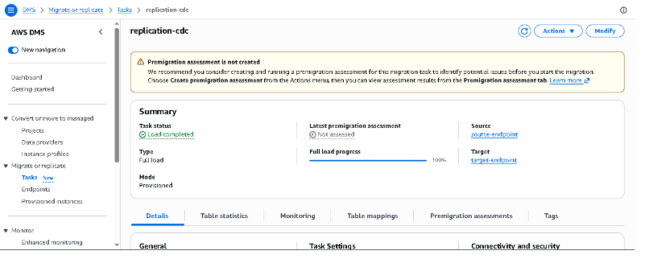
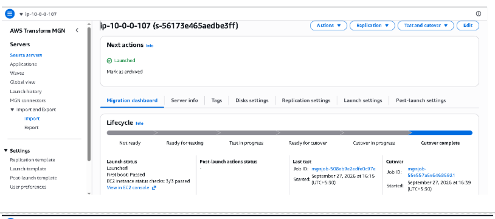
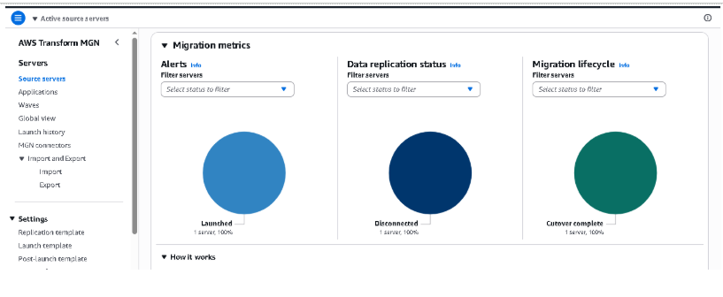

# AWS Migration – From On-Premises to AWS ☁️

## Overview

Migrating applications from On-Premises to AWS is not simply a matter of moving servers. A successful migration requires understanding the existing environment, preparing the organization and AWS foundation, selecting the right migration strategy, executing the migration and finally optimizing and modernizing the workloads.

This repository documents my understanding and learnings of the **AWS Migration journey**, following the three-phase approach:

**Assess → Mobilize → Migrate & Modernize**

The hands-on implementation covers:

* **Application Migration – Rehost using AWS MGN**
* **Database Migration – Replatform using AWS DMS**
* **Migration at Scale – Migration Waves**
* **Optimization & Modernization**

The detailed hands-on instructions are available in the official AWS workshop. This repository focuses on my **understanding, implementation screenshots and key takeaways**.

---

## 📑 Table of Contents

1. [AWS 3-Phase Migration Approach](#1-aws-3-phase-migration-approach)

   * [Assess](#11-assess)
   * [Mobilize](#12-mobilize)
   * [Migrate & Modernize](#13-migrate--modernize)
2. [Application Migration – Rehost with MGN](#2-application-migration--rehost-with-mgn)
3. [Database Migration – Replatform with DMS](#3-database-migration--replatform-with-dms)
4. [Migration at Scale – Migration Waves](#4-migration-at-scale--migration-waves)
5. [Optimization & Modernization](#5-optimization--modernization)
6. [Key Takeaways](#6-key-takeaways)
7. [AWS Workshop & References](#7-aws-workshop--references)

---

# 1. AWS 3-Phase Migration Approach

I would approach an application migration using AWS's recommended three-phase approach:

**Assess → Mobilize → Migrate & Modernize**



---

## 1.1 Assess

The objective of the **Assess** phase is to understand the current environment, evaluate cloud readiness, build the business case and align stakeholders.

### Initial Portfolio Discovery

First, I would understand the existing On-Premises environment:

* Applications and servers
* Application dependencies
* Database dependencies
* Network connectivity
* Infrastructure configuration
* Utilization and performance
* Business criticality

The goal is to answer:

> **What do we have, how are workloads connected and what should be migrated?**

### Migration Readiness Assessment

Next, I would evaluate the organization's readiness for cloud adoption through a **Migration Readiness Assessment (MRA)**.

The assessment looks at areas such as:

* Business
* People
* Governance
* Platform
* Security
* Operations

Given my previous experience in application security, I would also take a deeper look at:

* Identity and access management
* Permissions and privileged access
* Security monitoring
* Vulnerability management
* Threat detection and response
* Security and compliance controls

The objective is to understand the organization's **overall readiness and gaps for cloud adoption**.

### Build the Business Case

I would estimate:

* Current On-Premises cost
* Expected AWS cost
* TCO
* Potential savings
* Expected ROI
* Licensing considerations

### Stakeholder Alignment

Finally, I would align stakeholders on:

* Migration objectives
* Scope
* Success criteria
* Risks
* Timelines
* Roles and responsibilities

### Tools / Services

* AWS Transform
* AWS Migration Hub / AWS Transform migration capabilities
* AWS Pricing Calculator
* RACI

---

# 1.2 Mobilize

The objective of **Mobilize** is to close the gaps identified during the Assess phase and prepare the organization and AWS environment for migration.

### Detailed Portfolio Discovery

Go deeper into:

* Application dependencies
* Security requirements
* Compliance requirements
* Risk
* Business criticality
* Migration readiness

### Establish a Cloud Center of Excellence

A **Cloud Center of Excellence (CCoE)** can help:

* Establish cloud standards
* Define governance
* Train and upskill teams
* Establish operating models
* Drive cloud adoption

### Establish AWS Landing Zone

Prepare the AWS foundation covering:

* Multi-account structure
* Identity
* Networking
* Security
* Logging
* Governance
* Compliance

### Finalize Migration Strategy

Select the appropriate strategy for each workload:

**Rehost, Replatform, Refactor / Rearchitect, Repurchase, Relocate, Retire, Retain**

The decision depends on:

* Application complexity
* Business criticality
* Cost
* Risk
* Time-to-migrate
* Technical dependencies
* Modernization goals

### Migrate Pilot Workloads

Start with **low-risk and less-complex workloads** to:

* Validate the migration approach
* Test the AWS environment
* Identify gaps
* Build team experience
* Capture lessons learned

---

# 1.3 Migrate & Modernize

Once the organization and AWS environment are ready, migration can be executed at scale.

### Establish Repeatable Patterns

Use lessons learned from pilot migrations to standardize:

**Golden AMIs**

* OS configuration
* Application dependencies
* Security configurations
* Monitoring agents

**Infrastructure as Code**

* Terraform
* AWS CloudFormation

**Security & Compliance**

* IAM
* Security Groups
* Network ACLs
* Encryption
* Logging
* Monitoring

**Secrets Management**

* AWS Secrets Manager
* HashiCorp Vault

### Migrate Applications at Scale

Once the migration patterns are proven, migrate the remaining workloads using the selected migration strategy.

---

# 2. Application Migration – Rehost with MGN

### Migration Strategy

**Rehost / Lift & Shift**

AWS Application Migration Service (**MGN**) helps migrate servers to AWS with minimal application changes.

### Migration Flow

```text
Source Server
      ↓
MGN Agent
      ↓
Continuous Replication
      ↓
Test EC2
      ↓
Validate Application
      ↓
Cutover
      ↓
Finalize Migration
```

### Key Points

* Minimal application changes
* Continuous replication
* Test before cutover
* Reduced downtime
* Repeatable migration process

### My Hands-on Implementation

Screenshots demonstrating the MGN migration workflow are available in:

**`Screenshots/Application_Migration_Using_MGN`**








---

# 3. Database Migration – Replatform with DMS

### Migration Strategy

**Replatform**

AWS Database Migration Service (**DMS**) can migrate databases to AWS while supporting continuous replication.

### Migration Flow

```text
Source Database
       ↓
DMS Replication Instance
       ↓
Source / Target Endpoints
       ↓
Full Load
       ↓
Change Data Capture (CDC)
       ↓
Validate
       ↓
Cutover
```

### Key Points

* Full Load
* Change Data Capture
* Continuous synchronization
* Reduced downtime
* Managed migration process

### My Hands-on Implementation

Screenshots demonstrating the DMS migration workflow are available in:

**`Screenshots/Database_Migration_Using_DMS`**








## Application Final Cutover






---

# 4. Migration at Scale – Migration Waves

When migrating hundreds or thousands of servers, everything does not need to be migrated simultaneously.

Applications can be organized into **migration waves** based on:

* Dependencies
* Complexity
* Business criticality
* Risk
* Migration readiness

Example:

```text
Wave 1
Low-risk applications
        ↓
Wave 2
Medium-complexity applications
        ↓
Wave 3
Critical / complex applications
```

The idea is to:

**Start small → Learn → Validate → Improve → Scale**

This helps make migration more controlled and repeatable.

> **Note:** I have not implemented the MGN-at-scale exercise yet; this section represents my conceptual understanding.

---

# 5. Optimization & Modernization

Migration is not the end of the journey.

Once workloads are running successfully on AWS, the next step is to analyze the environment and optimize it.

### Cost Optimization

* Right-size resources
* Auto Scaling
* Optimize storage
* Evaluate Savings Plans / Reserved Instances
* Remove unused resources

### Performance

* Analyze utilization
* Optimize compute and database resources
* Introduce caching
* Use CloudFront where appropriate
* Improve application architecture

### Reliability

* Multi-AZ architecture
* Auto Scaling
* Backup and disaster recovery
* Fault-tolerant architecture

### Security

* IAM least privilege
* Encryption
* Security monitoring
* Vulnerability management
* Continuous compliance

### Operational Excellence

* Infrastructure as Code
* Monitoring and alerting
* Automation
* Standardized deployments
* Continuous improvement

### Modernization

Where appropriate, progressively move toward cloud-native architectures:

```text
VM
 ↓
Containers

Monolith
 ↓
Microservices

Servers
 ↓
Serverless

Self-managed Database
 ↓
Managed Database
```

A practical approach can be:

**Migrate → Stabilize → Measure → Optimize → Modernize**

> **Note:** I have not implemented the optimization section yet, so there are no hands-on screenshots for this section.

---

# 6. Key Takeaways

The key learning for me is that **AWS migration is not simply about moving workloads to the cloud**.

It is about:

**Assessing the environment → Preparing the organization → Choosing the right migration strategy → Executing the migration → Validating → Optimizing → Modernizing**

The migration strategy should be driven by the workload's:

* Business requirements
* Technical complexity
* Risk
* Cost
* Time-to-migrate
* Modernization goals

### In simple terms:

**Rehost → MGN → Move with minimal changes**

**Replatform → DMS → Move with limited changes**

**Modernize → Optimize / Refactor → Take advantage of cloud-native capabilities**

---

# 7. AWS Workshop & References

### AWS Migration Hands-on Workshop

[🔗 AWS Migration Workshop – Main](https://catalog.us-east-1.prod.workshops.aws/workshops/c6bdf8dc-d2b2-4dbd-b673-90836e954745/en-US/)

### Application Migration – MGN

[🔗 Application Migration using MGN](https://catalog.us-east-1.prod.workshops.aws/workshops/c6bdf8dc-d2b2-4dbd-b673-90836e954745/en-US/04-application-migration)

### Database Migration – DMS

[🔗 Database Migration using DMS](https://catalog.us-east-1.prod.workshops.aws/workshops/c6bdf8dc-d2b2-4dbd-b673-90836e954745/en-US/03-database-migration)

### MGN at Scale

[🔗 MGN Migration at Scale](https://catalog.us-east-1.prod.workshops.aws/workshops/c6bdf8dc-d2b2-4dbd-b673-90836e954745/en-US/04-application-migration/05-mgn-scale)

### Optimization

[🔗 AWS Optimization Workshop](https://catalog.us-east-1.prod.workshops.aws/workshops/c6bdf8dc-d2b2-4dbd-b673-90836e954745/en-US/06-optimization)

